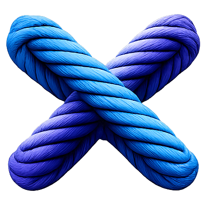
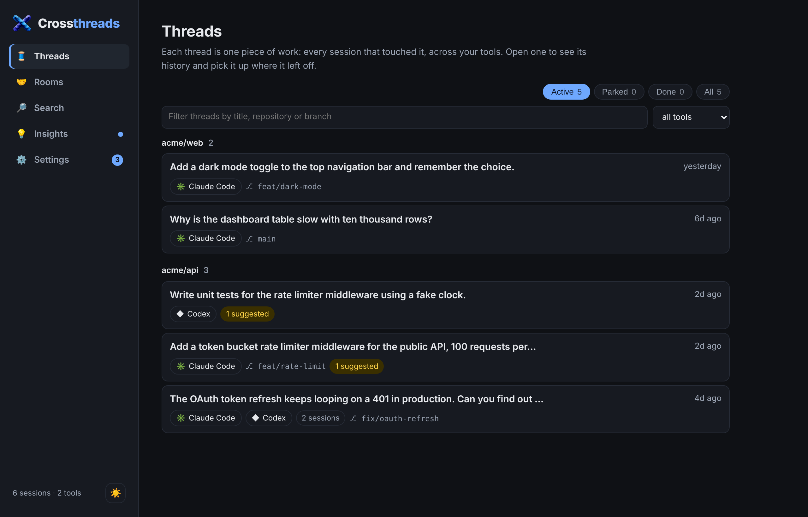
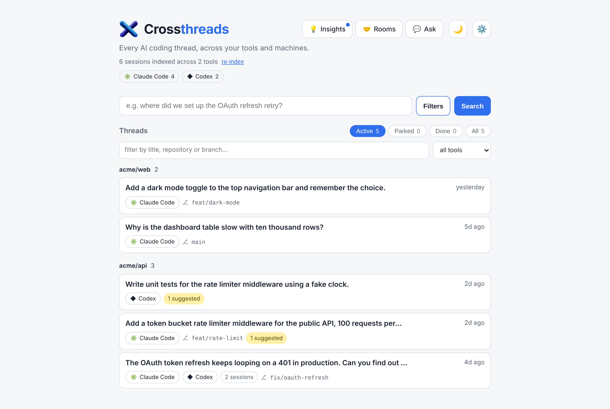
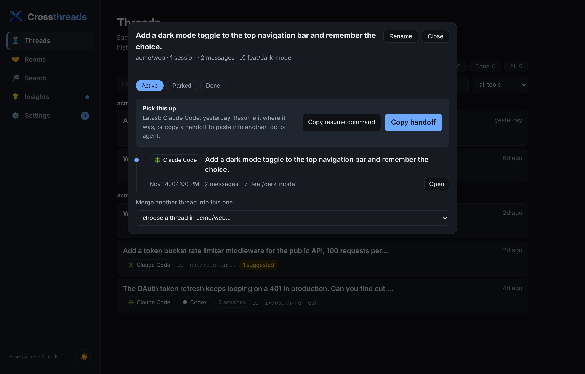
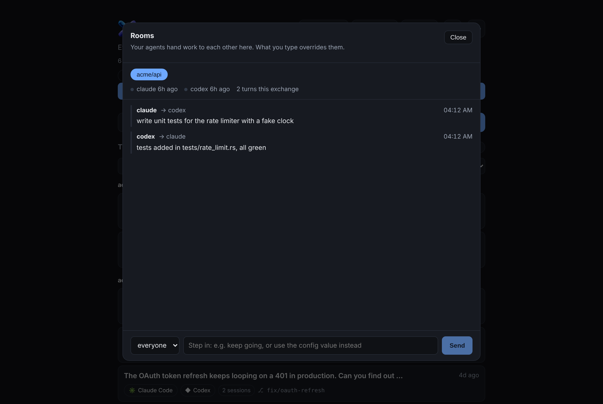
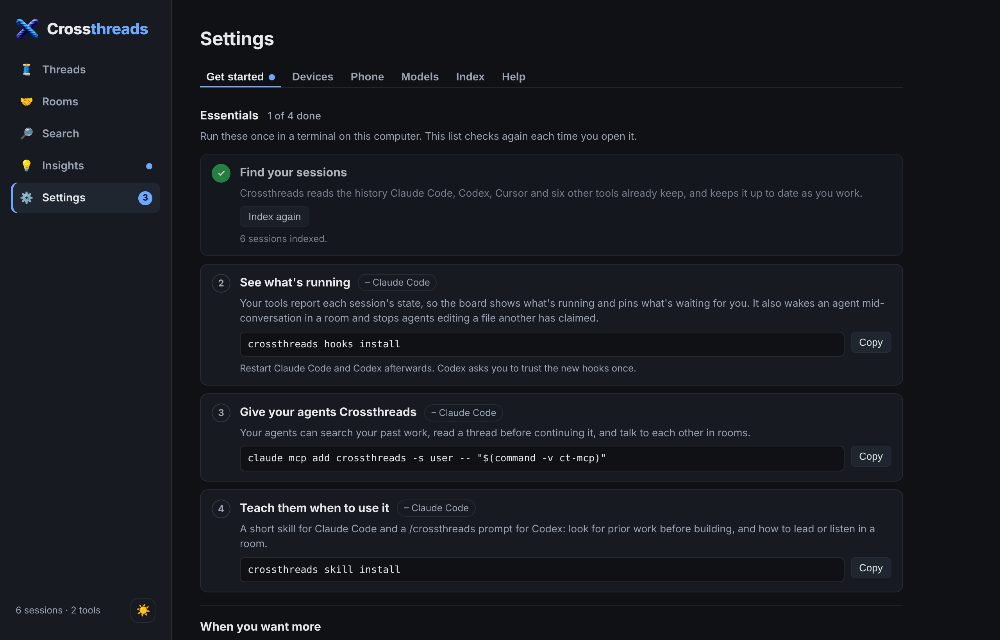
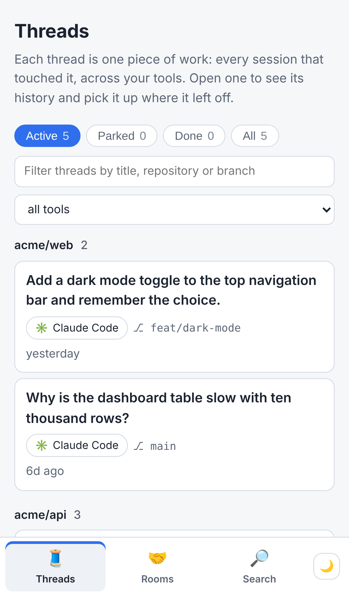
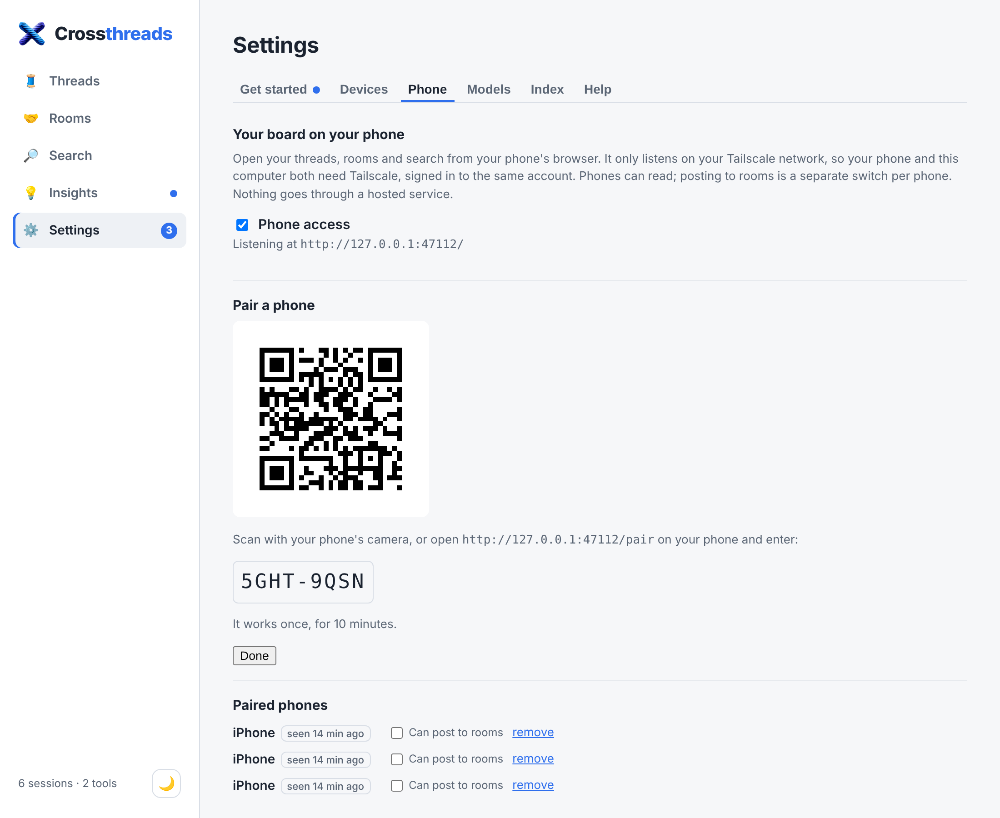

<div align="center">



# Crossthreads

**Every AI coding thread — across your tools, your machines and your phone — in one place. Search it, pick it up anywhere, and let your agents talk to each other.**

[](https://github.com/Cam-Smith-One/Crossthreads/actions/workflows/ci.yml)
[](LICENSE)
[](#-principles)
[](#-how-it-works)
[](#-for-agents-mcp)
[](CONTRIBUTING.md)

⚠️ Early Beta: Under active development. Expect a lot of rough edges.

<br/>



</div>

---

Crossthreads is a **local-first home for all your AI coding work**. You start something in Claude Code, continue it in Codex, ask Cursor a question about it, and then do the same on your other computer. Crossthreads pulls every one of those sessions into one place and turns them into **threads**: one entry per piece of work, whatever tool and machine it happened on.

From there you can:

- **See your work as one board.** One thread per piece of work, whichever tools and computers it spans, with what's running and what's waiting on you. Rename it, mark it done or leave notes from any of your computers.
- **Pick work back up anywhere.** Reopen the latest session in its own tool, or copy a handoff brief that another tool or agent can continue from.
- **Give your agents shared context.** Agents in any tool, on any of your computers, read a thread's decisions and open todos when they start and leave notes for the next one.
- **Let your agents talk to each other.** Claude and Codex hand work back and forth in a room for their repository, even on different computers, while you watch and step in.
- **Search everything you've ever discussed with an AI**, across nine tools and all your machines, by keyword or by meaning.
- **Check on it from your phone.** Open the board over your private Tailscale network, read-only unless you allow more.
- **Understand how you work.** Get cited answers from your own history, open loops, decisions, a weekly review, and measured habits.
- **Give it all to your agents.** 30 MCP tools let agents recall prior work, read and annotate threads, and use rooms.

Everything runs on your machines. There's no account, no telemetry and no hosted service. Adding a computer is a short code typed on it; devices then talk directly over your own Tailscale network, or through an end-to-end encrypted relay you host yourself.

> **Where's the thread where we fixed the OAuth refresh retry?** One query, every tool and machine.
>
> **What's running right now, what needs me, and where did I leave the rate limiter?** One board, also on your phone.

## Contents

- [Quick start](#-quick-start) · [What it does](#-what-it-does) · [Screenshots](#-screenshots) · [Set up](#-set-up)
- [Command line](#-command-line) · [For agents (MCP)](#-for-agents-mcp) · [Beyond search](#-beyond-search--understand-how-you-work) · [Supported tools](#-supported-tools)
- [Security and privacy](#-security-and-privacy) · [How it works](#-how-it-works) · [Documentation](#-documentation) · [Roadmap](#-roadmap) · [Contributing](#-contributing)

## 🚀 Quick start

**On a Mac, the easiest way is the app.** Download `Crossthreads-<version>-macos-universal.dmg` from the [latest release](https://github.com/Cam-Smith-One/Crossthreads/releases/latest) (one download for Apple Silicon and Intel), open it, and drag **Crossthreads** to Applications. Open it, and it indexes your sessions and shows the app; it lives in your menu bar too. Then **Settings → Get started → Connect Claude Code and Codex** is the one click left.

> The app isn't notarized by Apple yet, so the first time, **right-click it → Open → Open** (or run `xattr -dr com.apple.quarantine /Applications/Crossthreads.app`).

**On Windows, there's an app too.** Download `Crossthreads-<version>-windows-x64-setup.exe` from the same release and run it: it installs for your user only (no administrator needed) and works the same way, from the notification area instead of the menu bar. It isn't code-signed yet, so SmartScreen may warn the first time: **More info → Run anyway**.

**Or install from the terminal (macOS, Linux, Windows), no toolchain required:**

```sh
# macOS / Linux
curl -fsSL https://raw.githubusercontent.com/Cam-Smith-One/Crossthreads/main/scripts/install.sh | bash
crossthreads-up        # indexes your sessions, then opens the app, signed in
```

```powershell
# Windows (PowerShell)
irm https://raw.githubusercontent.com/Cam-Smith-One/Crossthreads/main/scripts/install.ps1 | iex
crossthreads-up
```

This installs to `~/.crossthreads` (`%USERPROFILE%\.crossthreads` on Windows), puts `crossthreads`, `crossthreadsd` and `ct-mcp` on your PATH, indexes whatever tools you have, watches for new sessions, and opens the web app. Downloads exist for Apple Silicon and Intel Macs, Linux (x86_64) and Windows.

The app is private to your account: it opens signed in, and if you open `http://127.0.0.1:47101` some other way, run `crossthreads open` to sign that browser in.

> On macOS the downloads aren't code-signed yet. If macOS refuses to open them, run `xattr -dr com.apple.quarantine ~/.crossthreads` and try again. Other snags: [**Troubleshooting**](docs/TROUBLESHOOTING.md).

Then, once, connect your AI tools:

```sh
crossthreads connect     # hooks, the agent skill and the MCP server, for Claude Code and Codex
```

Restart Claude Code and Codex afterwards (Codex asks you to trust the new hooks once). It's safe to run again whenever you update or move Crossthreads. **Settings → Get started** in the app shows what's connected. Details: [Set up](#-set-up).

<details>
<summary><b>Build from source</b> (Rust + Node)</summary>

```sh
# One command: build, index your real sessions, and open the app.
scripts/start.sh              # fast offline search
CT_ONNX=1 scripts/start.sh    # real semantic search (downloads all-MiniLM once)

# …or run the pieces directly:
cargo run --release -p ct-cli -- index
cargo run --release -p ct-cli -- search "oauth refresh retry" --mode hybrid
cd ui && npm install && npm run build && cd ..
cargo run --release --features onnx -p ct-daemon -- --http 127.0.0.1:47101 --ui ui/dist

# …or bring up a sample multi-tool corpus + UI:
CT_ONNX=1 scripts/demo.sh
```

> Prebuilt binaries use the deterministic offline embedder (instant, no network). Build with `--features onnx` for ONNX/all-MiniLM semantic search.

</details>

## ✨ What it does

The app has four places: **Home** (your threads, with Rooms and the weekly review a click away), **Search** (find, ask, and how you work), **Devices** (your computers and phones) and **Settings** (connect your tools, models, index, help). Each has its own address, so Back works and you can bookmark it.

### 🧵 Threads and the board

The home screen is your work as **threads**. A thread is one piece of work: every session that touched it, across tools, in time order. A Claude Code session you continued in Codex is one thread, not two.

- **Grouped by repository**, using a key that's the same on every machine and in every worktree, so `acme/api` on your laptop and on your desktop is one group.
- **Linked automatically** when a session continues another: a transcript transfer, a resume, or copied context. A session started in another tool around the same time is only **suggested**; you accept or dismiss it, and a dismissal is remembered.
- **Status** (active, parked, done), rename, merge and split. Your edits survive a full re-index.
- **Live state.** With `crossthreads hooks install`, Claude Code and Codex report what each session is doing. The board marks what's **running** and pins what **needs you** at the top. Without hooks, a session written to in the last 45 seconds shows as running (marked "inferred").
- **Across computers.** With your devices added, the board lists every computer's threads. Work that moved between computers is **one thread**: a session started from a handoff joins the thread it came from automatically, and you can join or separate threads by hand. Its name, status and notes are the same everywhere, and you can change them from any computer. Offline devices are named rather than silently dropped.
- **Notes.** Keep decisions, todos and context on a thread. Your agents read them and add their own.

Offline and deterministic: no model is involved. Available in the web app, `crossthreads threads`, and MCP.

### 🔁 Pick it up anywhere

Every thread has **Pick this up**:

- **Copy resume command.** The native way back into the latest session, for example `cd ~/work/api && claude --resume <id>` or `codex resume <uuid>`.
- **Copy handoff.** A Markdown brief with the repository, branch, every session, the original request, and where the latest session left off. Paste it into a different tool or agent to carry on without re-explaining. The same brief comes from `crossthreads thread <ID> --handoff` and the `crossthreads_thread` MCP tool with `handoff: true`.

### 🧠 Shared context for your agents

Agents forget everything between sessions, and they never knew what the other tool did. Crossthreads gives them the thread:

- **At the start of a session**, Claude Code gets a short brief through its session-start hook when there's something its own session can't know: decisions already made, open todos, and work on the same thread in another tool or on another computer, including what's running right now. (Turn it off in **Settings → Get started**.)
- **Any agent can ask** with `crossthreads_thread_context`, and **leave notes** with `crossthreads_note`: a decision and why, a todo left open, context the next agent needs. Notes travel to your other computers with the thread, and you see and edit them in the app.
- **Handoffs carry them too**, so pasting a handoff into another tool hands over the decisions as well as the transcript.

### 🤝 Rooms: your agents talk to each other

Stop being the copy-paste layer between your agents. Two agents working in the same repository share a **room** and hand work to each other directly: brief, implement, review, done.

- **One call per turn.** `send` posts and then blocks until the reply arrives, so agents never poll and a waiting agent costs nothing.
- **File claims** stop two agents editing the same file; a hook refuses the edit and names who holds it.
- **Auto-wake.** If an agent ends its turn mid-conversation, a hook hands it the next message instead of letting it stop.
- **You're in charge.** Watch every room live in the **Rooms** view and type into it; your messages override the agents. A message starting `DONE` ends the exchange, and an optional turn cap bounds unattended runs.
- **Remembered.** A finished exchange is indexed for search, and the two agents' sessions are linked into one thread.
- **Across your devices.** Once a computer is added, agents there join the same repository's room as `name@device`, e.g. `codex@linux-desktop` (you can switch this off per device). Messages arrive immediately, and a device that was offline catches up within about 10 seconds of reconnecting.

Works with Claude Code and Codex (any MCP-capable agent can use the tools), or two of the same. A shell fallback, `crossthreads room send|wait|history|claim|release`, covers chats opened before the tools were installed. Rooms replace the standalone Meat Proxy tool (`crossthreads room import` brings its history across).

### 🖥️ Across your devices

Add a computer in a few seconds: **Devices → Add a device** shows a code like `K7PQ-4XMN` on one computer; type it on the other. That's it: no token to make up, nothing to approve on both sides. Then one Crossthreads spans them all, with no index copying and no central server:

- **Search** fans out to every device and merges the results, tagged by device. Opening a result from another machine fetches it on demand.
- **Threads** are shared: one row per piece of work across computers, with the same name, status and notes everywhere.
- **Rooms** connect agents on different machines.

Devices talk directly over [Tailscale](https://tailscale.com). No Tailscale? Run the small `crossthreads-relay` somewhere you control and devices meet through it, end-to-end encrypted, so the relay can't read anything ([RELAY.md](docs/RELAY.md)). Each device keeps its own index and decides what it shares: you can keep tools or projects private per device. [Set up →](docs/MULTI_DEVICE_SETUP.md)

### 📱 Your board on your phone

**Devices → Add a device → A phone** (or `crossthreads phone on` then `crossthreads phone pair`). Your computer then serves the board to your phone's browser over Tailscale. Scan the QR code it shows, and that phone is paired.

- Read threads, rooms, transcripts and search from anywhere on your tailnet.
- **Read-only by default.** Letting a phone post to rooms (to steer your agents) is a separate switch per phone.
- Each phone gets its own revocable key. The listener binds only your Tailscale address, never every network interface, and nothing goes through a hosted relay. [Set up →](docs/PHONE.md)

### 🔎 Search everything

- **Hybrid search.** FTS5 keyword (BM25) plus semantic embeddings, fused with Reciprocal Rank Fusion, so it finds threads by meaning and not just by exact words.
- **Nine tools, one index:** Claude Code, Codex, Cursor, Aider, Cline, Copilot Chat, Gemini CLI, Windsurf and Antigravity, auto-detected and deduplicated, plus your Claude skills and Codex prompts.
- **Filters** by tool, kind (session, skill, room exchange), project and date. A **Save** star keeps sessions you'll want again; notes and tags too.
- **Actionable results.** Open the transcript, reveal the original file, copy the resume command, or build a paste-ready context block for a fresh agent.
- **Always current.** The daemon watches each tool's storage and indexes new sessions as they land.

| Mode | What it does | Best for |
|---|---|---|
| `lexical` | FTS5 / BM25 keyword search | exact terms, identifiers, error strings |
| `semantic` | cosine similarity over all-MiniLM embeddings | "the thread about login failing" finds *OAuth 401* |
| `hybrid` *(default)* | Reciprocal Rank Fusion of both | the best of each |

### 💡 Understand how you work

On top of the same index: **Ask** a question and get a cited answer from your own history; **insights** such as open loops, decisions, knowledge cards and recurring problems; **themes**; activity over time; a **weekly review**; and deterministic measures of how you work, with what to change next. [More below →](#-beyond-search--understand-how-you-work)

### 🖥️ A Mac app (and a Windows one)

`Crossthreads.app` (built with Tauri) is the web app in a native window, with the daemon, CLI and MCP server inside. The same app ships for Windows as a per-user installer (`Crossthreads-<version>-windows-x64-setup.exe`). It starts the daemon itself (replacing an older one), stays in your menu bar with a glance popover (usage against your baseline, next to the current insight), and in **Settings → Get started** connects Claude Code and Codex and adds the terminal commands at a click. See [`src-tauri/`](src-tauri/README.md).

## 📸 Screenshots

<div align="center">


<br/><sub>The board: threads by repository, across tools, with suggested links to review.</sub>
<br/><br/>


<br/><sub>A thread with <i>Pick this up</i>, and a room where Claude and Codex hand work back and forth.</sub>
<br/><br/>

<br/><sub>Settings → Get started: what's already set up on this computer, and the one command for each missing step.</sub>
<br/><br/>


<br/><sub>The board on a phone, and pairing one from Devices → Phones.</sub>
</div>

## 🧰 Set up

Each of these is optional and takes a minute. Crossthreads is useful as soon as `crossthreads-up` has run, and **Settings → Get started** in the app shows which of these are done on this computer.

| To get | Do this | Guide |
|---|---|---|
| **Claude Code and Codex connected**: live state, session-start briefs, room auto-wake, the claim guard, the 30 tools and the skill | `crossthreads connect` (or the one button in Settings → Get started), then restart them | [For agents](#-for-agents-mcp) |
| **Your other computers** in search, threads and rooms | Devices → **Add a device** on one, type the code on the other (both on Tailscale, or both using your relay) | [MULTI_DEVICE_SETUP](docs/MULTI_DEVICE_SETUP.md) |
| **The board on your phone** | Devices → **Add a device → A phone**, and scan the QR code | [PHONE](docs/PHONE.md) |
| **Model-backed insights** (Ask, weekly review, analyses) | Nothing, if Claude Code, Codex or Gemini CLI is signed in; or paste an API key in Settings → Models | [Beyond search](#-beyond-search--understand-how-you-work) |
| **A weekly review delivered to you** | `crossthreads schedule install --day mon --hour 9` | |

## ⌨️ Command line

Everything in the web app is also a command. `crossthreads help` lists them all.

```sh
# Find and reuse past work
crossthreads search "where did we set up the websocket reconnect?" --mode hybrid
crossthreads context "oauth refresh retry" > prior-context.md   # paste-ready block for a new agent
crossthreads resume <ID>                                         # the native command to reopen a session (--run to run it)

# Threads and the board
crossthreads threads                                             # your work as threads, grouped by repository
crossthreads threads --remote                                    # ask the daemon: live state and your other devices
crossthreads thread <ID>                                         # one thread: every session that touched it
crossthreads thread <ID> --handoff                               # a brief to continue it in another tool or agent
crossthreads thread link|unlink|reject|rename|status …           # regroup and organise threads
crossthreads note --kind decision "Keep the v1 API until mobile ships"   # a note on this folder's thread
crossthreads brief                                               # what an agent is told about this folder's thread

# Rooms
crossthreads room history --me claude                            # who is here, claims, recent messages
crossthreads room send --me claude --to codex "review src/auth?" # post and wait for the reply
crossthreads room import                                         # bring in a Meat Proxy database

# The app, devices, phone, your tools
crossthreads open                                                # open the web app, signed in (--print for the link)
crossthreads devices add                                         # show a code to type on your other computer
crossthreads devices join K7PQ-4XMN                              # …on that computer
crossthreads phone on | pair | off                               # the board on your phone (pair shows a QR code)
crossthreads connect                                             # hooks, skill and MCP for Claude Code and Codex

# Understand how you work
crossthreads metrics                                             # how you work, by the numbers (no model)
crossthreads optimize                                            # the biggest change to make now + a verdict on the last one
crossthreads trends | fluency | activity --by week | themes --k 8
crossthreads ask "how did we handle token refresh?"              # cited answer from your own history
crossthreads insight open_loops|decision_log|knowledge_cards|recurring|work_dna|gaps|prompt_coach|process_miner
crossthreads weekly                                              # your weekly review + one thing to try
crossthreads schedule install --day mon --hour 9                 # deliver it every week

# Housekeeping
crossthreads index | status | glance | llm-auth
```

## 🤖 For agents (MCP)

Point any MCP client at the `ct-mcp` binary (`crossthreads connect` does it for Claude Code and Codex) and your agent gets 30 tools. Your history, your threads, the rooms and your working profile all become part of its memory.

| Tool | Purpose |
|---|---|
| `crossthreads_search` | hybrid/semantic/lexical search with filters |
| `crossthreads_recall` | answer-oriented digest of relevant past sessions for a question |
| `crossthreads_ask` | a synthesized, **cited** answer to a question, from the user's history |
| `crossthreads_build_context` | render top matches into a paste-ready context block |
| `crossthreads_status` | index health and counts |
| `crossthreads_devices` | list the devices available to cross-device search |
| `crossthreads_themes` | cluster the user's sessions into themes (`name` for AI labels) |
| `crossthreads_threads` | the user's threads: pieces of work, each one or more sessions linked across tools |
| `crossthreads_thread` | one thread in full: every session that touched the work, in time order; `handoff: true` returns a brief to continue it |
| `crossthreads_thread_context` | what to know before working here: the thread's decisions, open todos and notes, and its sessions across tools and devices (who is running now) |
| `crossthreads_note` | keep a decision, todo or context on the thread for other agents and devices; mark a todo done |
| `crossthreads_room_send` | message another agent in this project's room (on this machine or `name@device`) and wait for the reply |
| `crossthreads_room_wait` | listen for the next room message |
| `crossthreads_room_history` | who is in the room, claims, and recent messages |
| `crossthreads_claim` / `crossthreads_release` | reserve files before editing them, and let them go |
| `crossthreads_activity` | session activity over time (day/week), with a per-tool breakdown |
| `crossthreads_metrics` | hard behavioral metrics on how the user works (turns, friction, delegation, languages, tempo) |
| `crossthreads_optimize` | the biggest change to make now + a measured verdict on the last one + trends |
| `crossthreads_trends` | how each working metric is trending (last 30 days vs previous) |
| `crossthreads_fluency` | AI-fluency across 4 dimensions (delegation/description/discernment/diligence), scored, + a reflective question |
| `crossthreads_weekly_review` | the user's weekly review: what they did, how they worked, one thing to try |
| `crossthreads_work_dna` | a quantified, evidence-backed profile of how the user works |
| `crossthreads_gaps` | gaps & blind spots, plus a personalized draft CLAUDE.md |
| `crossthreads_prompt_coach` | prompt coaching from the user's smoothest vs roughest sessions |
| `crossthreads_process_miner` | repeatable procedures mined into draft SKILL.md artifacts |
| `crossthreads_open_loops` | unresolved work, dangling TODOs, and unconfirmed fixes |
| `crossthreads_knowledge_cards` | durable Q→A cards worth remembering |
| `crossthreads_decision_log` | notable decisions ("chose X over Y because Z") with rationale |
| `crossthreads_recurring` | recurring problems/patterns the user keeps hitting, with fixes |

`metrics`, `search`, `threads`, `themes`, and `activity` work offline; the synthesis
tools (`ask`, `work_dna`, `gaps`, `prompt_coach`, `process_miner`, and the
`insight` family) use the user's model login.

```sh
# Claude Code
claude mcp add crossthreads -s user -- "$(command -v ct-mcp)"
```

```toml
# Codex: ~/.codex/config.toml
[mcp_servers.crossthreads]
command = "/Users/you/.crossthreads/bin/ct-mcp"   # the absolute path to ct-mcp
```

```jsonc
// any other MCP client
{ "mcpServers": { "crossthreads": { "command": "/absolute/path/to/ct-mcp" } } }
```

**Install the agent skill** so your tools proactively recall prior work (it
encodes "recall before you build, search when stuck"):

```sh
crossthreads skill install        # Claude Code skill + Codex /crossthreads prompt
```

`ct-mcp` **auto-starts `crossthreadsd`** on first use (and reuses one that's
already running — there's only ever one writer per index), so registering the
MCP server is the only step. Use the **absolute path** to `ct-mcp` so it can find
its sibling daemon. See [docs/AGENT_API.md](docs/AGENT_API.md) for the full
CLI/JSON, HTTP, and MCP contracts.

## 🧠 Beyond search — understand how you work

Search answers *"where's that thread?"*. The layer on top answers *"how do I work, and what should I do differently?"* — built from the **full width** of your indexed sessions (not just the text: turns, corrections, agent actions, languages, models, timings). All of it is local, opt-in for the model-backed parts, and available in the web app (💡 / 📋), the CLI, and over MCP.

| | What it tells you | How |
|---|---|---|
| 💬 **Ask** | A **cited answer** to any question, synthesized from your own past sessions across every tool. | `crossthreads ask "…"` · `crossthreads_ask` |
| 💡 **Insights** | **Open loops** (unfinished work), a **decision log**, **knowledge cards**, **recurring** problems you keep hitting — over your whole history including skills. | `crossthreads insight <kind>` · `crossthreads_open_loops`, … |
| 🧬 **Work DNA & metrics** | A quantified, evidence-backed profile of how you work — rhythm, **rework rate**, prompt **specificity**, **delegation** (agent actions/session), **languages**, **model mix**, **session length**, **time-to-first-response**, **error recovery**, **context-switching**, and where **friction** concentrates. The raw numbers need no model. | `crossthreads metrics` / `insight work_dna` · `crossthreads_metrics`, `crossthreads_work_dna` |
| 🎯 **Optimize (closed loop)** | Turns the metrics from *descriptive* into *prescriptive and verified*: the **single highest-impact change** to make now, then a week later a **measured verdict** on whether it worked (validation-gated), plus **trends** (↑ better / ↓ worse vs last month) and a running optimization log. Deterministic. | `crossthreads optimize` / `trends` · `crossthreads_optimize`, `crossthreads_trends` |
| 🧭 **AI-fluency + reflection** | The same signals organized around the **4D framework** — Delegation, Description, Discernment, Diligence — each **scored 0–100** with its movement, the metrics behind it, and a plain read. Ends on a **reflective question, not a to-do** (what to keep doing yourself), which you can talk through in *Ask*. Deterministic. | `crossthreads fluency` · `crossthreads_fluency` |
| 🩺 **Gaps & prompt coach** | What you start but don't finish and practices you're missing (+ a draft **CLAUDE.md**); plus your smoothest vs roughest sessions with **before→after rewrites** from your own prompts. | `crossthreads insight gaps` / `prompt_coach` |
| 🛠️ **Process miner** | Procedures you keep re-deriving, mined into **draft, installable `SKILL.md`** artifacts so you stop repeating them. | `crossthreads insight process_miner` · `crossthreads_process_miner` |
| 📋 **Proactive weekly review** | Without being asked: what you worked on, how you worked, and **one thing to try next week** — generated in the background and surfaced when ready. **Delivers itself** on a schedule you pick (launchd/cron) as a file + desktop notification. | `crossthreads weekly [--deliver]` · `crossthreads schedule` · `crossthreads_weekly_review` |
| 🗺️ 📅 **Maps** | A **theme map** of your sessions and a **temporal view** (activity over time). Offline. | `crossthreads themes` / `activity` |

> The deterministic parts (search, threads, metrics, themes, activity) never call a model. The synthesis parts (ask, insights, Work DNA, weekly review) reuse your existing **Claude Code / Codex / Gemini** login or a key you paste in Settings → Models — nothing leaves your machine unless you set that up.

## 🧩 Supported tools

These are the AI coding agents and assistants Crossthreads reads from. Each one
keeps its own conversation history in its own place and format — a `.jsonl` log
here, a SQLite `state.vscdb` there, Markdown somewhere else. Crossthreads has a
small **connector** per tool that:

1. **detects** whether the tool's data is present on your machine,
2. **reads it where it lives** (always **read-only** — open editors are fine),
3. **normalizes** every session into one common schema (tool, project, messages,
   timestamps), and
4. **deduplicates** by content hash into a single index.

So a single search spans *all* of them at once — no per-tool exporting, no
copy-paste. Add a tool to your workflow and its history shows up automatically on
the next index.

| Tool | What it is | Where Crossthreads reads it | Confidence |
|---|---|---|---|
| **Claude Code** | Anthropic's terminal coding agent | `~/.claude/projects/**/*.jsonl` | ✅ High |
| **Codex** | OpenAI's CLI coding agent | `~/.codex/sessions/**/rollout-*.jsonl` | ✅ High |
| **Cursor** | AI-first VS Code fork | `…/Cursor/User/**/state.vscdb` (composer + legacy chat) | ✅ High |
| **Aider** | Terminal pair-programmer | `**/.aider.chat.history.md` | ✅ High |
| **Cline** | Agentic VS Code extension | `…/<editor>/globalStorage/saoudrizwan.claude-dev/tasks/**` | ✅ High |
| **GitHub Copilot Chat** | Copilot's chat in VS Code | `…/<editor>/**/chatSessions/*.{json,jsonl}` | ✅ High |
| **Gemini CLI** | Google's terminal coding agent | `~/.gemini/tmp/*/chats/session-*.{json,jsonl}` | ✅ High |
| **Windsurf** | Codeium's agentic editor (Cascade) | `…/Windsurf/User/**/state.vscdb` | 🟡 Medium |
| **Antigravity** | Google's agentic IDE | Markdown artifacts under `~/.gemini/antigravity/` (best-effort)¹ | 🟠 Low |
| **Skills / prompts** | Reusable Claude `SKILL.md` + Codex prompts | `~/.claude/skills/**/SKILL.md`, `~/.codex/prompts/*.md` | ✅ High |

<sub>¹ Antigravity's full conversation lives in an undocumented protobuf format; Crossthreads scans the Antigravity home and indexes the readable Markdown task/plan artifacts (wherever they sit under it) until that format is documented. Connectors detect-and-skip gracefully and are stamped with a versioned fingerprint, so a format change degrades to "missed a session," never a crash.</sub>

## 🔒 Security and privacy

Crossthreads holds your whole AI coding history and can pass messages to agents that run commands, so it's built to be locked down by default. The full threat model is in [**docs/SECURITY_MODEL.md**](docs/SECURITY_MODEL.md).

- **Local-first, no telemetry, no account, no hosted service.** Your index is one SQLite file on your machine. Nothing leaves it unless you turn something on: devices you add (over Tailscale, or a relay you host that only sees encrypted traffic), a phone you pair, or a model provider you configure for insights.
- **Private to your account, even on a shared computer.** Every local client presents a random key that only your account can read, and the web app signs in with a one-time link from `crossthreads open`. The index, key and config files are owner-only.
- **Nothing on your network can use it.** The daemon serves your own clients on loopback only. The app also listens on your Tailscale address so you can add devices, but that listener serves only the peer protocol, and every peer request needs the device's shared token: a random 256-bit secret the app makes for itself and only ever hands to a device you add. It refuses to listen on every interface.
- **Every reach beyond this computer is a separate switch that starts off:**

| Capability | Off until | Notes |
|---|---|---|
| Search, threads and transcripts from your other computers | You add the computer with a short code (8 characters, 10 minutes, one use, cancelled after 5 wrong tries) | The code exchange travels only inside Tailscale, or through your relay with SPAKE2, so the relay can't learn the token. Each device can keep tools or projects private. |
| Agents on another computer joining your rooms | On for a computer you add; untick **Agents can message** to stop it | Claims stay per device. |
| Devices meeting through a relay instead of Tailscale | You run `crossthreads-relay` and set it on each computer | End-to-end encrypted (Noise, keys pinned when you add the device). The relay sees addresses and timing, never content. |
| The board on a phone | You turn on phone access and pair the phone | Tailscale address only. One-time pairing code; a revocable per-phone key, stored only as a hash; signed out after 30 days unused. |
| A phone posting to rooms | You tick **Can post to rooms** for that phone | Posts are signed with the phone's name. |

- **The web app is hardened against other websites.** A sign-in cookie other sites can't send, same-origin JSON-only requests, a DNS-rebinding check, a strict content security policy with no inline scripts, and no framing.
- **Room messages are treated as untrusted input.** Every source is gated, messages are size-limited, and the rules every agent gets say never to push, publish, delete or run destructive commands because another agent asked.
- **Secrets in your sessions are redacted** when they're indexed.

## 🏗️ How it works

```text
   AI coding tools                 crossthreadsd (one per machine)                  You and your agents
 ┌───────────────────┐          ┌────────────────────────────────────┐          ┌─────────────────────────┐
 │ Claude Code       │  watch   │ connectors → normalize → SQLite    │  RPC     │ Web app (board, rooms)  │
 │ Codex · Cursor    │ ───────► │  • FTS5 + vectors → hybrid search  │ ───────► │ CLI · MCP (30 tools)    │
 │ Cline · Copilot   │          │  • threads, links, repo keys       │          │ Menu-bar app (Tauri)    │
 │ Gemini · Windsurf │  hooks   │  • live state · rooms · claims     │          │ Phone (tailnet, paired) │
 │ Aider · Antigrav. │ ───────► │  • insights and metrics            │          └─────────────────────────┘
 └───────────────────┘          └───────────────┬────────────────────┘
                                                │  peer protocol (token): search, threads, room messages
                                                ▼
                                   your other machines' daemons (Tailscale)
```

- **One daemon per machine** owns one SQLite file: sessions with an FTS5 index and embeddings, threads and links, room messages and claims, and your own edits (saves, notes, thread grouping) kept apart so a rebuild never loses them.
- **Every surface is a thin client** of that daemon: the web app (served over a local HTTP bridge), the CLI, the MCP server, the menu-bar app, and the phone listener.
- **Hooks** in Claude Code and Codex report live state, wake an agent mid-conversation, and guard claimed files.
- **Across machines** daemons talk only through a token-checked peer protocol over Tailscale. Search and the board are fanned out on demand; room messages are relayed. No index is copied, and there's no central server.

```text
crates/
  ct-core         normalized schema, Connector trait, content hashing, repository keys, redaction
  ct-connectors   9 conversation connectors + skills/prompts
  ct-embed        Embedder trait: deterministic hash (default) + ONNX/all-MiniLM (`onnx`)
  ct-store        the SQLite index: search, threads and links, rooms and claims, themes, metrics
  ct-index        indexing and thread linking, shared by the CLI and daemon
  ct-llm          optional model backend: reuses your Claude/Codex/Gemini login (or a key you add)
  ct-daemon       crossthreadsd: the daemon, its protocol, HTTP bridge, watcher, live state,
                  rooms, federation, phone access, and insight synthesis
  ct-cli          the crossthreads command
  ct-mcp          the MCP server
ui/               React + Vite web app (also inside the Tauri shell and on phones)
src-tauri/        the native menu-bar shell
```

## 📚 Documentation

| | |
|---|---|
| [MULTI_DEVICE_SETUP](docs/MULTI_DEVICE_SETUP.md) | Connect your computers: search, the board and rooms across them |
| [PHONE](docs/PHONE.md) | Open your board on your phone over Tailscale |
| [SECURITY_MODEL](docs/SECURITY_MODEL.md) | What's protected, against whom, and how each boundary is enforced |
| [TROUBLESHOOTING](docs/TROUBLESHOOTING.md) | Fixes for common install, run and indexing issues |
| [AGENT_API](docs/AGENT_API.md) | The CLI/JSON, MCP and daemon interfaces: search, threads, rooms, devices, phone |
| [SPEC](docs/SPEC.md) | The product spec: threads, board, rooms, workspaces, dispatch; milestone status |
| [ARCHITECTURE](docs/ARCHITECTURE.md) · [DECISIONS](docs/DECISIONS.md) | Components, data model, process model; architecture decision records |
| [CROSS_DEVICE_SEARCH](docs/CROSS_DEVICE_SEARCH.md) | How federation works and why (ADR-010) |
| [DEVELOPMENT](docs/DEVELOPMENT.md) | Build, test, run the daemon, UI and MCP; the `onnx` feature; releasing |
| [CHANGELOG](CHANGELOG.md) | What changed in each release |
| [PRD](docs/PRD.md) · [REQUIREMENTS](docs/REQUIREMENTS.md) · [ROADMAP](docs/ROADMAP.md) | The original product intent and requirements |

```sh
scripts/check.sh   # everything CI runs: fmt + clippy + tests + UI build
scripts/demo.sh    # bring up the full stack against a sample corpus
```

## 🗺️ Roadmap

- ✅ Connectors for 9 tools + skills/prompts, hybrid search, daemon, web UI, MCP (30 tools), durable bookmarks/pins, notes & tags, prebuilt releases, **cross-device search** (federation over Tailscale)
- ✅ **Understanding layer:** cited **Ask** (RAG), **insights** (open loops / decisions / cards / recurring), theme map, temporal view, **behavioral metrics + Work DNA / gaps / prompt coach / process miner**, a **proactive weekly review**, an **optimize** closed loop, and a **4D AI-fluency** view with reflective prompts — all reusing your existing model login
- ✅ **Native menu-bar app (Tauri)** — a tray icon that toggles a compact **glance** popover fusing per-tool usage (today vs. your baseline) with the insight read (fluency, unresolved threads, optimize focus); Mac + Windows + Linux
- ✅ **Scheduled weekly-review delivery** — `crossthreads schedule install` wires a launchd agent (macOS) or a managed crontab line (Linux) to run `crossthreads weekly --deliver` on the cadence you pick; the review lands as a file + a desktop notification
- ✅ **Resume, unified** — one canonical `resume` op (daemon · `crossthreads resume` · UI) gives the native way back into a session: `claude --resume <id>` / `codex resume <uuid>` (with `cd <project>`), reveal-the-transcript otherwise
- ✅ **Live quota via a documented sidecar** — the glance renders a real rate-limit window whenever an on-device reader writes `~/.crossthreads/quota/<tool>.json`; Crossthreads never scrapes provider internals
- ✅ **Threads and the board**: one identity per piece of work across tools, machine-independent repository keys, automatic and suggested links, and the board as the home screen
- ✅ **Live state and the cross-device board**: hooks report what each Claude Code and Codex session is doing; the board pins what needs you and lists your other machines' threads
- ✅ **Pick it up anywhere**: copy a resume command or a handoff brief for any thread
- ✅ **Rooms**: agent-to-agent messaging with file claims, auto-wake, and a live view you can type into; replaces the standalone Meat Proxy tool
- ✅ **Rooms across devices**: agents on different machines share the same repository's room, behind a per-device *Can message* grant
- ✅ **The board on your phone**: paired, read-only by default, over Tailscale only
- ⏳ Next from the [spec](docs/SPEC.md): a packaged Mac app (`.dmg`), workspaces (a git worktree per task), and dispatch (start an agent on another machine)
- ⏳ A bundled on-device quota reader; richer cross-tool deeplinks
- 🔭 `sqlite-vec` ANN for very large corpora, one thread across machines (ADR-011), community connector plugins

See [docs/ROADMAP.md](docs/ROADMAP.md) for the phased plan mapped to requirement IDs.

## 🤝 Contributing

Contributions welcome — see [CONTRIBUTING.md](CONTRIBUTING.md) and the [Code of Conduct](CODE_OF_CONDUCT.md). Adding a connector is a self-contained change: implement the `Connector` trait, register it in `builtin()`, and add a regression fixture. Security issues: please report privately per [SECURITY.md](SECURITY.md).

> **Status:** early beta. Everything above is implemented and covered by tests, and prebuilt releases are published for macOS (Apple Silicon and Intel), Linux and Windows. Not yet publicly announced.

## 🧭 Principles

1. **Local-first & private by default** — no telemetry; your data never leaves your machine unless you opt in.
2. **Better than grep** — hybrid lexical + semantic retrieval with natural-language queries.
3. **Actionable, not just searchable** — every result can be opened, resumed, or injected.
4. **Understanding, not just retrieval** — your history reveals how you work; metrics are deterministic, narratives cite them.
5. **Resilient connectors** — tool formats change; detection is versioned and degrades gracefully.
6. **Agent-friendly** — agents query Crossthreads over CLI/JSON and MCP.
7. **Every reach is a grant** — another computer, agents messaging across machines, a phone, and a phone posting are each off until you turn them on.

## 📄 License

[Apache-2.0](LICENSE) © Crossthreads contributors.
