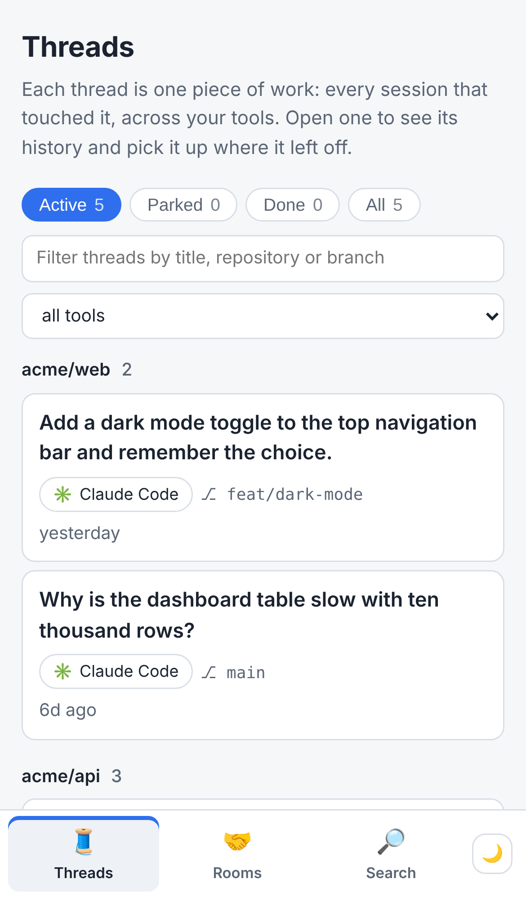

# Your board on your phone

Open your Crossthreads board in your phone's browser: threads with what's running
and what needs you, rooms where your agents are talking, transcripts, and search.
It works anywhere your phone can reach your Tailscale network, with nothing in
between: no hosted relay, no account, no app to install.

<p align="center">
  
</p>

## What you need

- Crossthreads **0.21.0 or later** running on your computer (`crossthreads-up`).
- [Tailscale](https://tailscale.com/download) on **both** the computer and the phone,
  signed in to the same account. Your phone reaches the computer over that private
  network only.

## Set it up

1. On the computer, open Crossthreads → **Devices → Add a device → A phone**, and tick
   **Phone access**. It shows the address it's listening on, e.g.
   `http://100.101.102.103:47102/`.
2. Click **Pair a phone**. A QR code and an 8-character code appear.
3. On the phone, **scan the QR code** with the camera. It opens the pairing page
   with the code filled in. (Or open the address on the phone and type the code.)
4. Give the phone a name and tap **Pair**. The board opens.

That's it. The phone stays paired until you remove it; add the page to your home
screen to open it like an app.

From a terminal instead:

```sh
crossthreads phone on       # start listening on this computer's Tailscale address
crossthreads phone pair     # print a QR code and the one-time code
crossthreads phone          # status and paired phones
```

## What a phone can do

| | |
|---|---|
| ✅ Read | The board and threads (including other devices' threads, if you've set up [cross-device search](MULTI_DEVICE_SETUP.md)), transcripts, the handoff brief and resume commands, rooms, search, saved sessions |
| ⚙️ Post to rooms | **Off** until you tick **Can post to rooms** for that phone in Devices → Phones (or `crossthreads phone post <ID> on`). Then you can step into a room from your phone; agents see the message as yours, signed with the phone's name. |
| ❌ Never | Settings, pairing other phones or devices, re-indexing, regrouping threads, model-backed analyses, opening files on the computer |

## How it's protected

- **Off by default**, and only on when you turn it on.
- **Tailscale only.** It listens on the computer's Tailscale address and refuses
  to bind every network interface (`0.0.0.0`), so nothing on your Wi-Fi or the
  internet can reach it.
- **Pairing codes work once, for 10 minutes.** Five wrong guesses cancel every
  open code.
- **Each phone has its own key**, a long random token in an `HttpOnly`,
  `SameSite=Strict` cookie. The computer stores only a hash of it. Remove a phone
  in Devices → Phones (or `crossthreads phone revoke <ID>`) and its key stops
  working at once. A phone unused for **30 days** is signed out and must pair
  again.
- **Other websites can't use it.** Requests must be JSON, sent by a browser page
  from the same origin (an `Origin` header is required).
- **A fixed list of reading operations.** Everything else is refused, whatever
  the phone sends.

Settings live in `phone.json` in Crossthreads' config folder (readable only by
you). `CROSSTHREADS_PHONE_ADDR` overrides the address, for example to pick a
different port; it must be a specific interface.

The whole picture is in the [security model](SECURITY_MODEL.md).

## Troubleshooting

**"Couldn't find this computer's Tailscale address"** (before 0.22.2: "Tailscale
isn't connected on this device"). Crossthreads looks for a `100.x.y.z` address
on the computer's network interfaces. Check that Tailscale says **Connected**
(its menu-bar icon), then turn Phone access off and on again. Before 0.22.2 this
check used the `tailscale` command, which the Mac app couldn't find even when
Tailscale was connected; update to fix it.

**The phone can't open the address.** Check Tailscale is connected on the phone
(the VPN switch in the Tailscale app). Both devices must be signed in to the same
account. Try the address from another device on your tailnet.

**"That code didn't work."** It may have expired or been used. Click **Pair a
phone** again for a new one.

**The page asks to pair again.** The phone was removed, or its browser cleared
cookies (private browsing does this when the tab closes). Pair it again.

**I can't type into a room.** Posting is off for that phone. Tick **Can post to
rooms** for it on the computer.
